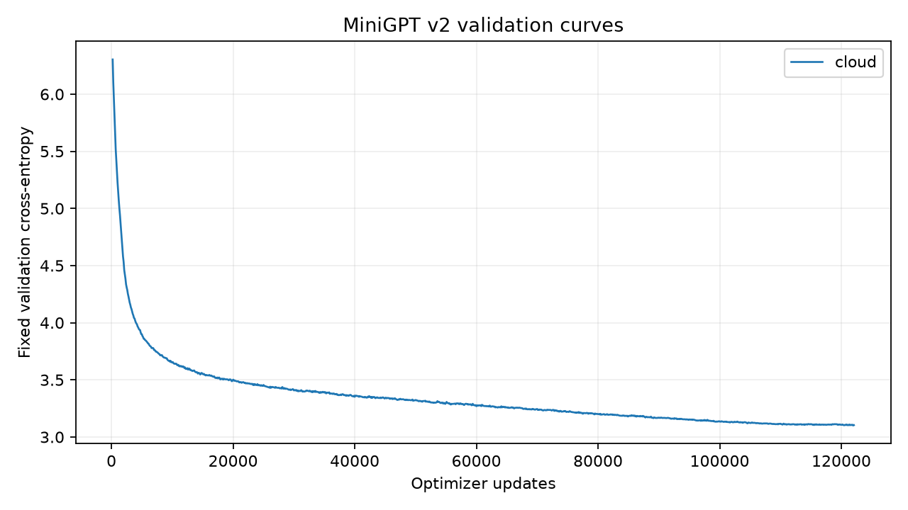

# MiniGPT 云端预训练结项记录

核验日期：2026-11-21。本轮完成单卡小型语言模型预训练，任务为英文下一 token 预测。项目不具备通用助手或企业生产模型的能力证明。

## 实际完成情况

| 项目 | 实测结果 |
| --- | --- |
| 模型参数 | 98,032,128 |
| 结构 | 12 层、宽度 768、12 头、512 token 上下文、16,384 BPE |
| 硬件与精度 | 单张 RTX 4090D 24GB，BF16 混合精度 |
| 不同训练语料 | 300,001,097 个准备 token，内容散列划分角色、精确去重 |
| 训练计划与完成 | 122,071 步全部完成，2,000,011,264 个累计训练目标 |
| 最佳权重 | 第 122,000 步，固定开发窗口 loss 3.10138 |
| 最后一步 | 第 122,071 步，固定开发窗口 loss 3.10365 |
| 完整验证切分 | loss 3.03804，PPL 20.8644，1,467,199 个目标 |
| 完整独立测试切分 | loss 3.03213，PPL 20.7413，1,499,973 个目标 |
| 正式接续运行耗时 | 18,402.14 秒，约 5 小时 7 分；不含 pilot、初始化和导出 |
| 平均训练吞吐 | 108,594.60 token/s，包含验证和存盘开销 |
| 峰值分配显存 | 10,149,069,824 bytes，约 9.45 GiB |
| LAMBADA OpenAI | 5,153 题，896 题命中，17.3879% |
| 最后词 PPL | 206.79 |
| 实际总支出 | 15.28 元，包含准备、训练、评测与结束后的空闲时间 |
| 实例状态 | 已关机，最后一次无卡整理于 18:03:17 结算，控制台已关机 |

训练的“20 亿”是累计目标量，含重复采样，并非 20 亿不同语料。固定开发窗口每次评分 32,768 个目标。完整验证和测试切分分别包含 1,467,199 与 1,499,973 个目标，使用步幅 256、上下文 512、FP32 交叉熵和 `strided_all_targets_once` 口径，结果见[完整切分评测](../experiments/cloud/full_validation_test.json)。

[完整训练状态](../experiments/cloud/cloud_status.json)、[训练摘要](../experiments/cloud/training_summary.json)、[原始训练日志](../experiments/cloud/cloud_formal.log)、[公开任务报告](../experiments/cloud/cloud_lambada.json)、[来源与训练环境](CLOUD_TRAINING.md)保留可复核证据。

## 与本机版本的关系

本机约 507 万参数模型在同一完整 LAMBADA 任务上命中 5/5153（0.097%），云端约 9803 万参数模型命中 896/5153（17.39%）。文本、任务和完整词贪心判断一致，但词表、上下文、模型、语料和训练量都改变。这是整套配方的结果对照，不能将增益单独归因于扩大参数。

LAMBADA 曾用于前期问题诊断；FineWeb-Edu 语料尚未完成公开任务污染检查。结果不能声称为完全盲测或无污染成绩。当前表现也不能解释为已经达到同规模公开模型的全部能力。

## 关机失败与费用复盘

训练、模型导出、完整状态备份和 LAMBADA 在约 04:49 完成。收尾代码直接通过 subprocess 执行 `/usr/bin/shutdown`，触发 `OSError: [Errno 8] Exec format error`，没有完成脚本关机。平台预先设置的 07:30 定时关机随后生效，控制台与最终账单均已核对。

从 04:49:13 到 07:30:07 约空闲 2 小时 41 分，按 1.88 元/小时估算费用约 5.04 元；这是估算归因，不是平台单独列出的计费项目。总账单实付 15.28 元，低于本轮 50 元上限。

修复后的 `scripts/autodl_poweroff.py` 先直接执行命令，仅遇到 ENOEXEC 时改由 Bash 解释该文件，其他错误继续暴露。测试覆盖正常执行、格式错误回退和权限错误传播；本次没有为验证关机另开收费 GPU。平台定时关机仍保留为独立保护，脚本返回也不能代替控制台确认。

参考了 [AutoDL 官方的 shell / os.system 调用方式](https://www.autodl.com/docs/save_money/)和 [AutoDL-cli 的任务清理设计](https://github.com/Minato-Aqukin/AutoDL-cli)。这是本轮真实故障与修复记录，未删除失败日志。

## 产物与后续边界

云端共享存储保留 `cloud_model.zip`、`cloud_training_state/`、来源审计、环境、完整日志和评测报告，位于免费容量内；实例本地数据仍按平台保留周期存在。未执行释放或删除。

模型包已在本机校验整包与包内 SHA256，加载第 122,000 步最佳权重并生成三组固定提示样例；完整记录见 [模型包验证](../experiments/cloud/artifact_verification.json)和 [生成样例](../experiments/cloud/generation_samples.json)。样例仍有明显循环和事实编造，未筛掉失败输出。优化器状态与推理包区分保存，前者用于恢复训练，后者用于推理分发。大权重使用 GitHub `v2.0.0` 版本附件，服务器端摘要与本地一致，代码、配置和证据进入仓库。

本轮作为基础训练工程项目结项。进一步数据扩展、指令微调或多模态任务应另立实验计划，按开源调研、比较、验证的规则推进；本次没有启动额外收费训练。

### 模型包传输恢复

网页下载 348 MiB 模型包时多次中断。保留其中 296,992,768 bytes，云端计算该前缀 SHA256 并与本机匹配，再用无卡模式将剩余部分拆为四个 16 MiB 文件和一个尾文件。逐片及重建整包校验通过，ZIP CRC 与推理包内 SHA256 也通过。未修改任何模型权重。原始 ZIP 大小 365,327,134 bytes，SHA256 为 `eefca7dbcab57eb5605ddfa3ef398001581fdf32790ff2bfc868961cbd7b837d`。

无卡模式标价 0.10 元/小时，本次最低结算 0.01 元；先设 18:30 平台关机保护，拆分完成后通过控制台提前关机，18:03:17 结算。前一 GPU 阶段 15.27 元加本次 0.01 元，最终总计 15.28 元。分片清单见 [传输校验](../experiments/cloud/transfer_manifest.json)。
